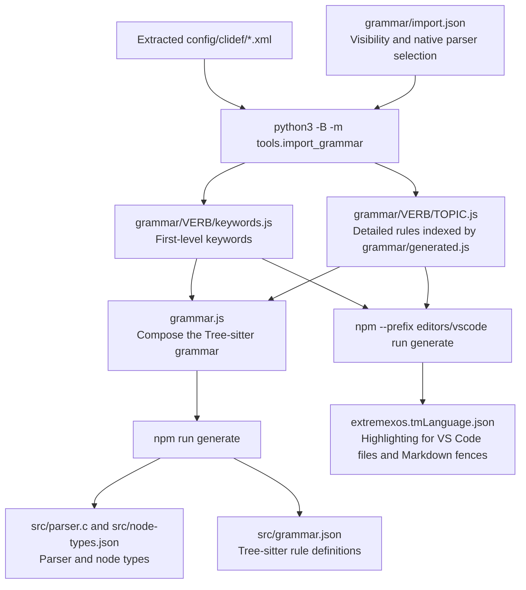

# tree-sitter-extremexos

A [Tree-sitter](https://tree-sitter.github.io/tree-sitter/) grammar for configuration files and CLI command lists for Extreme Networks switches running ExtremeXOS.

The grammar provides named nodes for module headers, comments, CLI verbs, and their known first-level keywords. The VS Code build uses every public XML family. The default native parser uses detailed rules for selected families. Other first-level keywords have named nodes with generic arguments.

## Scope

This grammar deliberately targets canonical configuration files exported by ExtremeXOS. It does not attempt to recognize every abbreviation or context-sensitive shortcut accepted by the interactive CLI. For example, an exported `configure vlan "VLANname" ...` command can be parsed without knowing which VLANs exist; checking that the name corresponds to a preceding `create vlan` command belongs in a separate semantic analysis layer. Unknown commands and dynamic interactive targets are preserved through generic fallbacks rather than rejected.

## VS Code

The [VS Code extension](editors/vscode/README.md) adds syntax highlighting for `.exos` and `.exosconfig` files and Markdown fences.

## Development

```sh
npm install
npm run generate
npm test
npx tree-sitter parse examples/example.exos
```

Corpus tests live in `test/corpus`; representative configuration exports live in `test/fixtures`.
The root `grammar.js` composes command-family modules from `grammar/`; detailed families can grow there without obscuring the top-level grammar.

### Generate a standalone grammar from firmware XML

`tools/clidef_to_grammar.py` reads one extracted `config/clidef/*.xml` file and emits a standalone Tree-sitter grammar. It was tested with `edgeAuto.xml`, `kcm.xml`, and `twamp.xml` from ExtremeXOS 32.7.3.15. The generator follows shared group closers and uses action entries to identify where a command can end. Optional branches share their continuation rules, so the output stays compact with many independent options.

```sh
work=$(mktemp -d)
python3 tools/clidef_to_grammar.py /path/to/edgeAuto.xml > "$work/grammar.js"
cd "$work"
tree-sitter generate --abi 14
```

The generated syntax tree names each command by its leading keyword and gives operands named fields. It uses the `argument` field when several operand labels share the same lexical rule at the same position. The grammar recognizes fixed choices declared by unquoted static custom types. Numeric ranges, dynamic names, and platform capabilities depend on device-level validation. The generator reports unsupported tree structures.

Run the converter's tests with `python3 -B -m unittest discover -s test/tools`.

### Regenerate syntax from CLI XML

Supply an extracted `config/clidef` directory. The importer merges definitions of the same command across XML files and shares continuations between related command forms.



```sh
python3 -B -m tools.import_grammar /path/to/config/clidef
npm run generate
npm --prefix editors/vscode run generate
npm test
git add -N grammar/
git diff
```

[`grammar/import.json`](grammar/import.json) defines which verb and topic pairs receive detailed rules in the default native parser. Add pairs there to expand coverage and run the same commands. An unsupported XML definition stops the import before generated files are changed.

The XML importer and VS Code build use every public family by default. Public verbs are discovered from XML, including script commands and options such as `cat -n`. The importer retains `--all` as a compatibility alias. VS Code highlighting can be generated or packaged immediately after the import. For a full Tree-sitter build, CLI 0.26.9 includes a [reachability performance fix](https://github.com/tree-sitter/tree-sitter/pull/5584) for large grammars. Use `EXOS_FULL_PARSER=1 npm run generate` to generate all families locally with ABI 14.

Each import prints coverage counts for the full XML grammar. Add `--coverage coverage.json` to the import command for a sorted list of XML command prefixes with their status, reason, and source filenames. A prefix is a verb alone when it can end there, or a verb and its next keyword or operand. Bare verbs are counted as covered. Operand-first forms can have detailed continuations, such as `then` following the expression in an `if` command. Excluded prefixes carry an XML visibility flag or an explicit exclusion in the import configuration. A skipped prefix has no corresponding imported rule and may still parse through a fallback. The report measures prefix coverage, not every possible complete command line.

Generated trees expose a named node for each verb and topic and named fields derived from XML operands. If several operand names share the same lexical position, the field is named `argument`. Subcommand keywords are literal tokens within the family node. VS Code follows the same shared continuation rules for highlighting.

Run `tools/test_full_import.sh /path/to/config/clidef` to verify the full native build in a temporary directory. It generates the ABI 14 parser, checks XML-derived fields on EDP commands, and parses the example configuration and fixtures. Set `TREE_SITTER_CLI` to the absolute path of another CLI executable to test that version.
