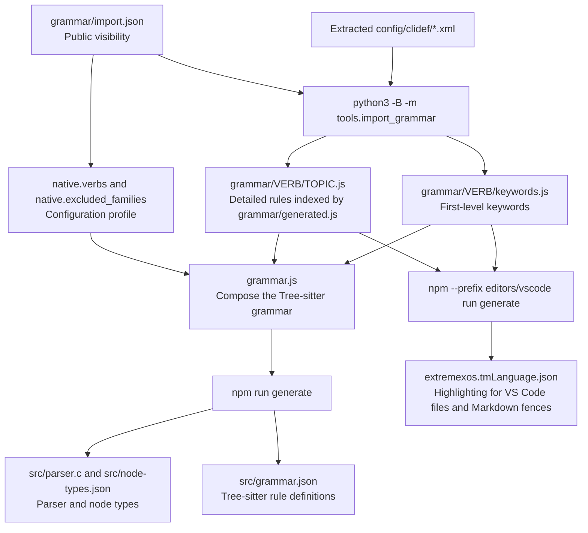

# tree-sitter-extremexos

A [Tree-sitter](https://tree-sitter.github.io/tree-sitter/) grammar for configuration files and CLI command lists for Extreme Networks switches running ExtremeXOS.

The native Tree-sitter parser provides detailed syntax and operand fields for configuration commands. The VS Code TextMate highlighter uses the complete public command catalog, including operational commands such as `show` and `debug`.

## Scope

This grammar deliberately targets canonical configuration files exported by ExtremeXOS. It does not attempt to recognize every abbreviation or context-sensitive shortcut accepted by the interactive CLI. For example, an exported `configure vlan "VLANname" ...` command can be parsed without knowing which VLANs exist; checking that the name corresponds to a preceding `create vlan` command belongs in a separate semantic analysis layer. Unknown commands and dynamic interactive targets are preserved through generic fallbacks rather than rejected.

The native configuration profile includes every imported family under `configure`, `create`, `delete`, `disable`, `enable`, and `unconfigure`: currently 563 families. This is a conservative superset for expressing and editing persistent configuration, including inverse operations that an ordinary export might omit. It includes specialist features such as dynamic routing, authentication, and QoS. Operational verbs retain named command nodes with generic arguments; their individual topics and options are detailed only in the TextMate highlighter.

[`grammar/import.json`](grammar/import.json) defines the native profile through `native.verbs` and `native.excluded_families`. Family exceptions retain a named topic with generic arguments. The checked-in rules have no exact export-membership flag, so exceptions must be justified explicitly. Changes to this profile can be generated entirely from the checked-in catalog; firmware XML is needed only to refresh that catalog and is not included in the repository.

The syntax trees are a foundation for configuration editing. IntelliSense requires a separate completion provider, which is not part of the current VS Code extension.

## VS Code

The [VS Code extension](editors/vscode/README.md) adds syntax highlighting for `.exos` and `.exosconfig` files and Markdown fences.

## Development

```sh
npm install
npm run generate
npm test
npx tree-sitter parse examples/example.exos
```

Corpus tests live in `test/corpus`; representative configuration exports live in `test/fixtures`.
The root `grammar.js` composes command-family modules from `grammar/`; detailed families can grow there without obscuring the top-level grammar.

`npm run generate` uses the pinned Tree-sitter CLI 0.26.9, preserves language ABI 14, and checks that state IDs and action indices fit the runtime's 16-bit parse tables. `npm test` repeats the size check before compiling or loading the parser. The configuration profile currently uses a largest action index of 60,315 out of 65,535; extending its scope requires checking that budget. Generated C source size is about 18.07 MB and is not the size of the compiled library.

### Build and release the VS Code extension

From the repository root, build the extension using the checked-in command families:

```sh
cd editors/vscode
npm ci
npm run generate
npm test
npm run package
```

The tests cover standalone files and Markdown fences. Packaging refreshes the TextMate grammar and writes the VSIX to `editors/vscode/`. To use updated XML definitions, follow [Regenerate syntax from CLI XML](#regenerate-syntax-from-cli-xml) before packaging.

Pull requests and pushes to `main` check the generated highlighting and run the file and Markdown tests. To prepare a release, update the extension version and lockfile, commit, and push a matching tag (for example, `vscode-v1.0.1` for version `1.0.1`). The workflow packages that commit and attaches the VSIX to a draft GitHub Release. Install the attachment to check it, then publish the draft when ready.

Publishing the GitHub Release triggers the Marketplace job. It downloads the reviewed VSIX from the release and publishes it using GitHub OIDC. In the Marketplace publisher’s Trusted Publishing policy, use owner `aaronaxvig`, repository `tree-sitter-extremexos`, and workflow `vscode.yml`. Leave the environment field empty. The publish step uses vsce 4.1.0 for OIDC support.

### Generate a standalone grammar from firmware XML

`tools/clidef_to_grammar.py` reads one extracted `config/clidef/*.xml` file and emits a standalone Tree-sitter grammar. It was tested with `edgeAuto.xml`, `kcm.xml`, and `twamp.xml` from ExtremeXOS 32.7.3.15. The generator follows shared group closers and uses action entries to identify where a command can end. Optional branches share their continuation rules, so the output stays compact with many independent options.

```sh
work=$(mktemp -d)
python3 tools/clidef_to_grammar.py /path/to/edgeAuto.xml > "$work/grammar.js"
cd "$work"
tree-sitter generate --abi 14
```

The generated syntax tree names each command by its leading keyword and gives operands named fields. It uses the `argument` field when several operand labels share the same lexical rule at the same position. The grammar recognizes fixed choices declared by unquoted static custom types. Numeric ranges, dynamic names, and platform capabilities depend on device-level validation. The generator reports unsupported tree structures.

Run the converter's tests with `python3 -B -m unittest discover -s test/tools`.

### Regenerate syntax from CLI XML

Supply an extracted `config/clidef` directory. The importer merges definitions of the same command across XML files and shares continuations between related command forms.



```sh
python3 -B -m tools.import_grammar /path/to/config/clidef
npm run generate
npm --prefix editors/vscode run generate
npm test
git add -N grammar/
git diff
```

The importer always generates the full public catalog independently of the native profile. Continuations can be shared across any command-family files; native composition resolves those shared rules before Tree-sitter removes unreachable definitions. An unsupported XML definition stops the import before generated files are changed.

The XML importer and VS Code build use every public family by default: currently 1,017 families. Public verbs are discovered from XML, including script commands and options such as `cat -n`. The importer retains `--all` as a compatibility alias. VS Code highlighting can be generated or packaged immediately after the import. CLI 0.26.9 includes a [reachability performance fix](https://github.com/tree-sitter/tree-sitter/pull/5584) for large grammars. The experimental `EXOS_FULL_PARSER=1` mode selects the entire catalog for native generation, but that scope is not supported while its action indices overflow. The size check rejects such output before native tests compile it.

Each import prints coverage counts for the full XML grammar. Add `--coverage coverage.json` to the import command for a sorted list of XML command prefixes with their status, reason, and source filenames. A prefix is a verb alone when it can end there, or a verb and its next keyword or operand. Bare verbs are counted as covered. Operand-first forms can have detailed continuations, such as `then` following the expression in an `if` command. Excluded prefixes carry an XML visibility flag or an explicit exclusion in the import configuration. A skipped prefix has no corresponding imported rule and may still parse through a fallback. The report measures prefix coverage, not every possible complete command line.

Generated configuration trees expose a named node for each verb and topic and named fields derived from XML operands. If several operand names share the same lexical position, the field is named `argument`. Subcommand keywords are literal tokens within the family node. VS Code follows the same shared continuation rules for highlighting across the complete catalog.

For full-catalog sizing experiments, `tools/test_full_import.sh /path/to/config/clidef` imports and generates in a temporary directory. It stops if the resulting tables overflow; once they fit, it checks EDP operand fields and parses the example configuration and fixtures. Set `TREE_SITTER_CLI` to the absolute path of another CLI executable to test that version.
